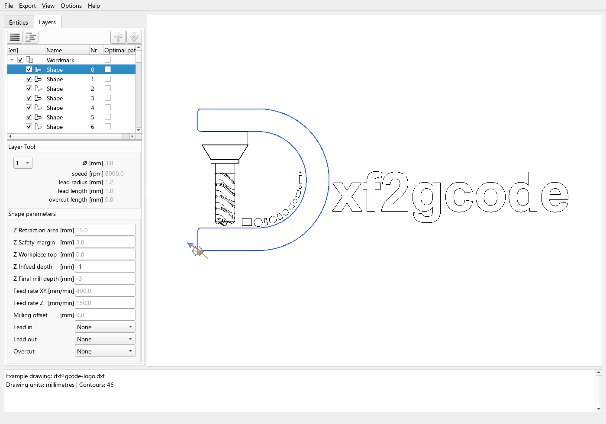
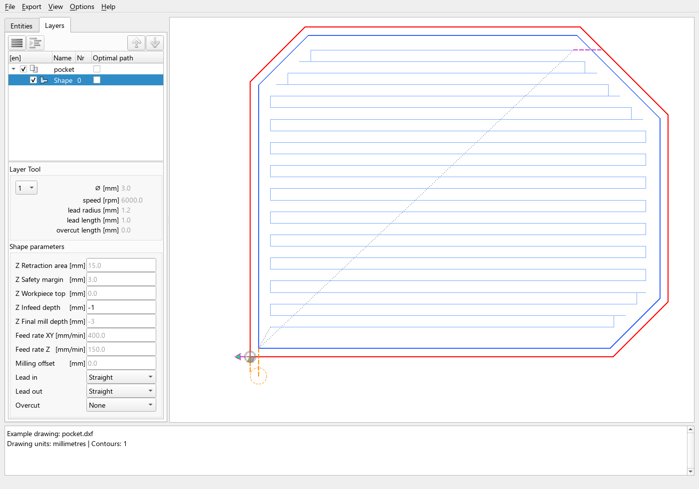
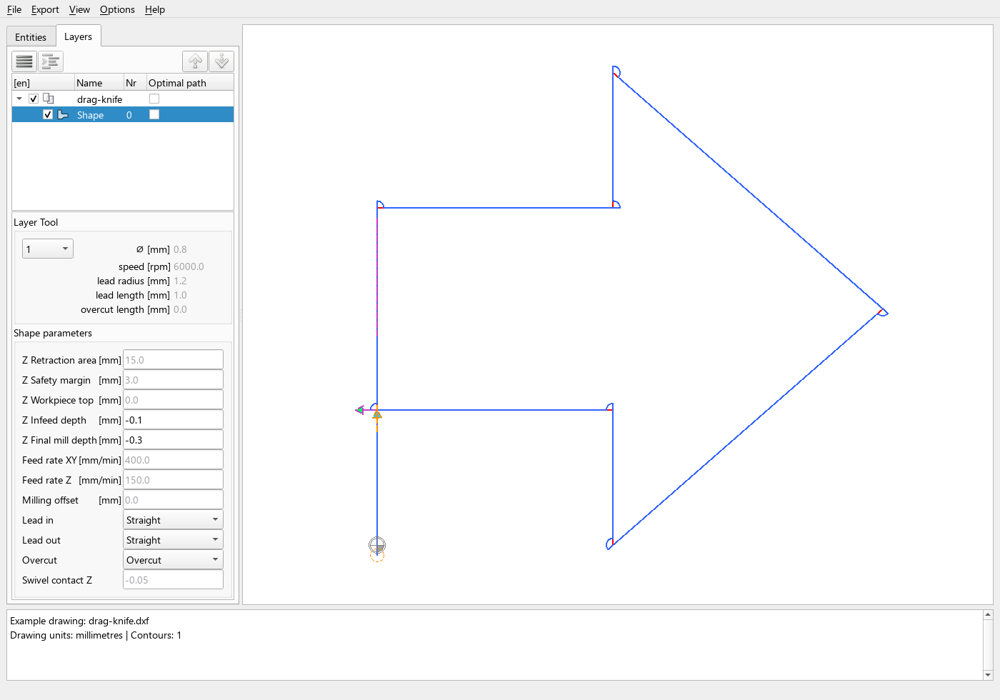

  

<strong>Turn 2D drawings into CNC toolpaths.</strong> 
Open-source DXF to G-code conversion for milling, turning and drag-knife cutting.

  <a href="https://github.com/dxf2gcode/dxf2gcode/releases"><strong>Downloads</strong></a> ·
  <a href="https://dxf2gcode.github.io/dxf2gcode/"><strong>Documentation</strong></a> ·
  <a href="https://github.com/dxf2gcode/dxf2gcode"><strong>Source code</strong></a> ·
  <a href="https://github.com/dxf2gcode/dxf2gcode/issues"><strong>Report an issue</strong></a>

### From drawing to toolpath

Import a DXF drawing, select contours, configure tools and machining parameters,
inspect the planned paths, and export through a configurable postprocessor.

Our own logo, loaded as a drawing in DXF2GCODE.
[Try the example DXF](https://github.com/dxf2gcode/.github/blob/main/examples/dxf2gcode-logo.dxf).

| Milling | Drag-knife cutting |
| --- | --- |
|  |  |
| Pocket paths, cutter compensation and configurable lead moves. | Blade offset, corner swivels, lead moves and overcut. |

Click an image to inspect it at full size. These examples illustrate planning
and preview; the postprocessor and machining parameters depend on your machine.

### Towards 2.0

The next stable target is **2.0.0**: a restructured codebase, a common plan for
preview and G-code export, expanded machining options and a new home on GitHub.
The documentation is being built alongside development.

[Develop previews](https://github.com/dxf2gcode/dxf2gcode/releases?q=develop-ci-&include_prereleases=1)
are published after automated tests and package checks. Downloads include
Windows x64 ZIP/MSI, a Python wheel and a source archive, with SHA-256 checksums.
**Develop packages are previews; Windows packages are initially unsigned.**

For earlier releases, visit the
[historical SourceForge archive](https://sourceforge.net/projects/dxf2gcode/files/).
